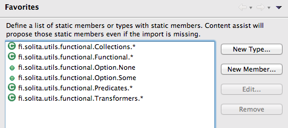

# More-or-less functional util library for Java.

Code generation (https://github.com/solita/meta-utils) is highly recommended since it provides first-class-functions in regular java code, thus greatly lessening the pain of using functional constructs.

## Java6?

Looking for Java6 compatible version? See branch `java6`.

## Installing

Add the following file (or the latest version) to classpath:

https://github.com/solita/functional-utils/releases/download/0.8/functional-utils-0.8.jar

You might also want to use *Eclipse favorites* (any similar thing in Idea?) so that you don't jave to write so many import clauses.
Add the following types/functions to *Eclipse Preferences -> Java -> Editor -> Content Assist -> Favorites*:

## Examples

Just a few examples of using these utils.

* [Builders and Lenses](src/test/java/fi/solita/utils/functional/lens/BuilderAndLensExamples.java)
* [Collections](src/test/java/fi/solita/utils/functional/CollectionsExamples.java)
* [Comparisons](src/test/java/fi/solita/utils/functional/CompareExamples.java)
* [Tuples](src/test/java/fi/solita/utils/functional/TupleExamples.java)
* [Functions](src/test/java/fi/solita/utils/functional/FunctionExamples.java)
* [Monoids](src/test/java/fi/solita/utils/functional/MonoidExamples.java)
* [Pattern matching](src/test/java/fi/solita/utils/functional/MatchExamples.java)
* [Common functional stuff](src/test/java/fi/solita/utils/functional/FunctionalExamples.java)

## Word of warning

This package comes with no warranty what-so-ever. It's higly experimental, might contain loads of bugs and needs more testing.
Packages and classes may get renamed or moved, and things may suddenly break.
Use at your own risk!

Bug reports, feature requests and opinionated recommendations are highly welcome ;)

## License

Copyright © Solita Oy

Distributed under the MIT License.
